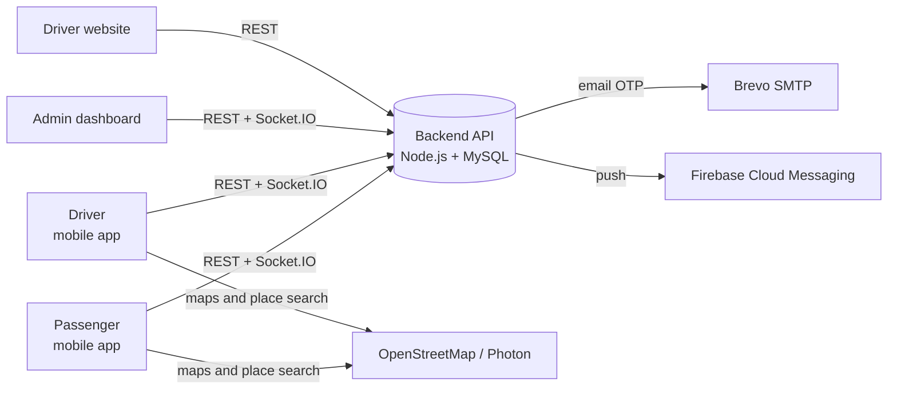
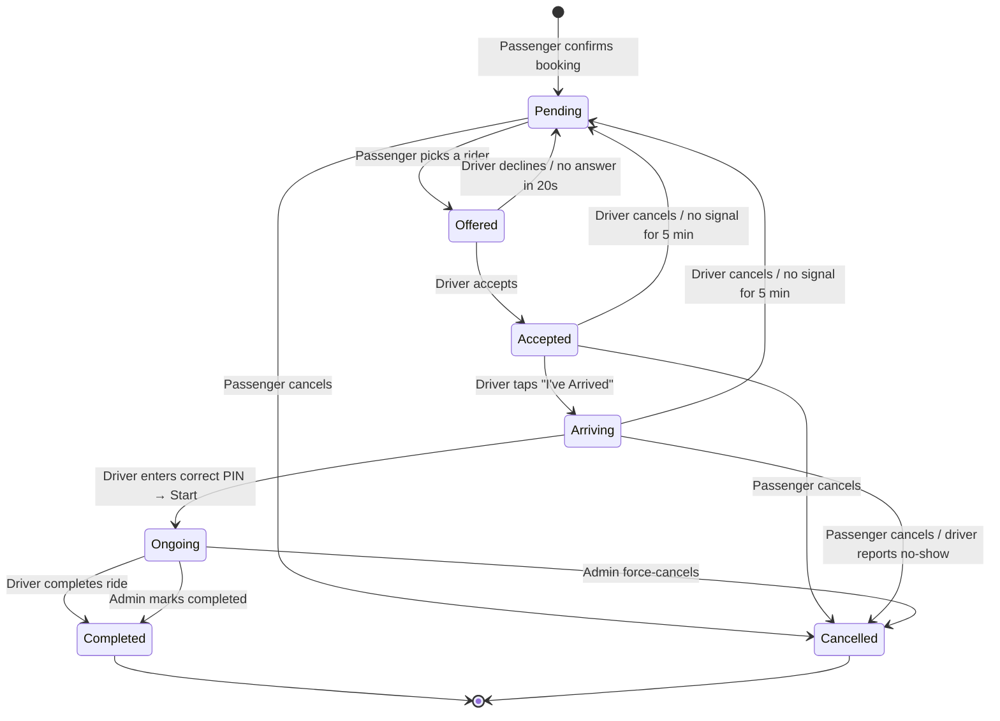

# FindMeTricycle — Features and System Flow

A tricycle booking system for **Guiuan, Eastern Samar**. Passengers book in the app, choose a nearby tricycle driver, and pay **cash** at the end of the trip.

> Last updated: October 3, 2026. Update this document whenever the system changes.

**Contents**
1. [System components](#1-system-components)
2. [Users and accounts](#2-users-and-accounts)
3. [Features: Mobile app (passenger)](#3-features-mobile-app-passenger)
4. [Features: Mobile app (driver)](#4-features-mobile-app-driver)
5. [Features: Driver application website](#5-features-driver-application-website)
6. [Features: Admin dashboard](#6-features-admin-dashboard)
7. [Features: Backend and automatic processes](#7-features-backend-and-automatic-processes)
8. [Flows, step by step](#8-flows-step-by-step)
9. [Fare calculation](#9-fare-calculation)
10. [Configurable settings](#10-configurable-settings)
11. [Known gaps](#11-known-gaps)
12. [Running the system](#12-running-the-system)

---

## 1. System components

| Component | Folder | Technology | Used by |
|---|---|---|---|
| **Mobile app** | `mobile_app/` | Flutter (Android) | Passengers and drivers — one app with a **Passenger Mode** and a **Driver Mode** |
| **Admin dashboard** | `admin_dashboard/` | React + Vite | The LGU / operator admin |
| **Driver application website** | `driver_apply/` | React + Vite | People applying to become drivers (apply and check status) |
| **Backend API** | `backend/` | Node.js, Express, MySQL, Socket.IO | All of the above |



- **REST API** (`/api/...`): sign-in, bookings, profiles, admin actions.
- **Socket.IO**: live updates — new ride requests, driver location, ride status changes.
- **Push notifications (Firebase)**: reach the phone even when the app is closed. *(Requires setup — see [§11](#11-known-gaps).)*

---

## 2. Users and accounts

| User | How the account is created | What they can do |
|---|---|---|
| **Passenger** | Signs up in the app with an email address (verified by OTP) | Book rides, rate drivers, send SOS, file reports |
| **Driver** | The **same passenger account**, approved by the admin as a driver | Everything a passenger can, plus switch to **Driver Mode** to take rides |
| **Admin** | The **first** admin signs up during first setup (with email OTP) and becomes the **Super Admin**. Every other admin is added by a Super Admin from **Admin Accounts** — one account per person, each with **one role**. | What their role allows (below) |

**One account, two modes.** There is no separate driver account. A passenger approved as a driver gets **"Switch to Driver Mode"** under Profile and can switch back to Passenger Mode at any time.

**Admin roles.** Each admin has exactly one role. The backend checks the role's permissions on every request and socket event; the dashboard only shows what the role allows.

| Role | Can do |
|---|---|
| **Super Admin** | Everything, including **Admin Accounts**, Earnings (and export), Activity Logs, Barangay Coverage, Fare Settings and Settings. Receives **SOS escalations**. |
| **Operations Admin** | Dashboard, Live Map, Users, Driver Applications, Approved Drivers, Bookings (including Force Cancel / Mark Completed), Ride History, Complaints, Notifications, Announcements, Reports. **No** SOS, earnings or system settings. |
| **SOS Responder** | Dashboard (SOS and live-ride widgets only), Live Map, **SOS** (acknowledge and resolve), the booking an SOS was raised on, and SOS notifications. |

The permission list lives in one file: `backend/src/constants/admin-permissions.js`. Driver documents (license, permit, selfie) are visible only to roles with driver-application access.

---

## 3. Features: Mobile app (passenger)

### Account
- **Sign up:** email → 6-digit OTP by email (valid 5 minutes) → name, mobile number, password → signed in automatically.
- **Log in:** with email or mobile number. Clear errors such as *"This email is not registered."* or *"Invalid password. Please try again."* — what was typed stays in the fields.
- **Forgot Password:** email → new password → OTP by email.
- **Change Password** (Settings): current password + new password + OTP. Signs out every **other** device.
- **Edit Profile:** name, phone, email, address, photo. Warns when the email or phone is already used by another account.
- **Delete Account:** requires the password; not allowed during a ride. Afterwards the phone and email can be used for a new account.

### Booking a ride
- **Home:** map with the **live positions of online drivers** and quick access to Saved Places.
- **Booking flow:** Pickup → Destination → Number of passengers (1–5) → Fare estimate → Confirm.
  - Search for a place, use the current location, or drop a pin on the map.
  - **Guiuan only:** maps open on Guiuan with everything outside its boundary dimmed; place search only returns places inside Guiuan (the islands included). When the service area is enforced (`GEOFENCE_ENABLED=true`), maps can't be panned or zoomed far away, and a pickup or destination outside Guiuan is refused with *"This location is outside Guiuan. FindMeTricycle only operates within Guiuan."* A passenger whose GPS is outside Guiuan sees a short notice explaining this.
- **Choose a rider:** list of the nearest online drivers (up to 10, within **5 km**) with name, tricycle number, rating and distance.
- **Ride Status:** the driver's live location, the status ("Driver on the way", "Arrived", "In progress"), and the **4-digit pickup PIN** to give the driver.
- **Cancel:** allowed while choosing a rider, after the driver accepts, and **while the driver is at the pickup point**. Not allowed once the trip has started.
- **After the trip:** Ride Completed → **rate the driver** (1–5 stars and a comment). Each ride can be rated once.

### Other features
- **My Rides (history):** list and **Ride Details** (date, places, fare, driver, tricycle), with **Rate Driver**, **Save to Favorites** and **Book Again**.
- **Saved Places (Favorites):** save frequent destinations.
- **Safety:** **SOS** (sends an alert with the location to the admin), emergency hotline (call), and the current ride's details.
- **Notifications:** an inbox — **unread items stand out**, and tapping one **opens the full message** with the ride number, fare and reason.
- **Contact Support:** call or email, using the contacts set in the admin Settings.
- **Settings:** dark mode, language, notification preferences, sound effects, vibration, default passenger count, location permission; Help Center and FAQ, Terms of Service, Privacy Policy.
- **Become a Driver:** opens the driver application website.
- **Report a Problem:** send a report to the admin.

---

## 4. Features: Mobile app (driver)

- **Online / Offline:**
  - Requires GPS on, location permission and an internet connection.
  - While Online, a **"You're online" notification** keeps GPS running even with the phone locked (Android foreground service).
  - The driver is set Offline automatically if GPS, permission or internet is lost.
- **Status pills:** GPS · Internet · Location Sharing.
- **Ride requests:** pop-up with vibration and **20 seconds** to **Accept** or **Decline**.
- **Active Ride:**
  1. **I've Arrived at Pickup**
  2. Ask the passenger for the **PIN** → **Start** (the correct PIN is required; 5 attempts).
  3. **Complete Ride** — the final fare is computed; the passenger pays cash.
  - **Passenger No-Show** (after arriving) — closes the ride and files a report.
  - **Cancel Ride** before the trip starts (with a reason) — the passenger picks another rider.
- **Earnings:** Today, This Week, This Month, a chart of the last 7 days, lifetime totals, performance (cancellation rate), milestones, and the list of completed rides.
- **Ride History:** All / Completed / Cancelled filters, with the passenger's rating and comment.
- **Profile and Settings:** edit profile (including tricycle number), change password, notifications, auto-online, Report a Problem.
- **SOS** during a ride.
- **If the app is restarted** during a ride, the Active Ride comes back.

---

## 5. Features: Driver application website

**Pages:** Home · How it Works · Safety · About · Download · Driver Info · **Apply** · **Application Status** · Contact

**Application flow** (see also [§8.5](#85-applying-to-become-a-driver)):
1. **CAPTCHA** (Google reCAPTCHA)
2. **Sign in** with the passenger account from the app
3. **Email OTP**
4. **Application wizard** (5 steps):
   1. *Personal Information:* full name, email, contact number, address, emergency contact (name and number)
   2. *Driver Information:* license type, tricycle / plate number, franchise / permit number (optional)
   3. *Required Documents:* photos of the **Driver's License** and **Franchise / Permit**. The license is read by OCR and must show an **LTO license number** and the **applicant's name** before it's accepted.
   4. *Identity Verification:* selfie / liveness check
   5. *Review & Submit:* confirm the name, license number and birth date that were read from the license
- **Application Status:** pending, needs correction, approved or rejected, with a timeline. When *needs correction* or *rejected*, the applicant can **resubmit**.

---

## 6. Features: Admin dashboard

| Section | What it does |
|---|---|
| **Login / Setup** | First-time setup (email OTP) only while no admin exists. **Forgot Password** uses the admin's **own email** (OTP). "Remember me". A disabled admin can't sign in. |
| **Role-aware interface** | The sidebar, dashboard widgets, action buttons, search results and notifications show only what the admin's role allows. Each page has its own URL (e.g. `#/bookings`); opening a page the role doesn't include shows a **"No access"** page. The top bar shows the admin's name and role. |
| **Dashboard** | Summary: total rides, today's earnings, online and approved drivers, passengers, pending applications, ongoing rides, rides completed and cancelled today, SOS alerts, licenses expiring soon, and the latest bookings and driver registrations — each only if the role covers it. |
| **Live Map** | Live locations of online drivers, rides in progress and **open SOS alerts**, with Guiuan's boundary outlined. Opens fitted to Guiuan; anything outside the boundary is labelled **"Outside service area"** and listed with a **Show on map** button — the map always reaches it. A driver counts as online only while their location is less than 60 seconds old. |
| **Users** | Passenger list with search, filters and ride counts; **Suspend / Reinstate** (a suspended user is signed out immediately). |
| **Driver Applications** | Status tabs, document previews, **document-check results** (OCR). Actions: **Approve** (asks for confirmation when a document looks suspicious), **Reject** (with a reason), **Request Correction**. Application timeline. |
| **Approved Drivers** | Ride counts, status, licenses expiring soon, **Suspend / Reinstate**, **Revoke approval**. |
| **Bookings** | Search and status filter; **booking detail** with a timeline. For a stuck ride: **Force Cancel** (any stage) or **Mark Completed** (credits the driver the fare), with a required reason. |
| **Ride History** | All completed and cancelled rides. |
| **SOS** | Alerts from passengers and drivers with the sender, message and location. **Open → Acknowledged ("I'm handling this") → Resolved** with a required note. Only one admin can acknowledge an alert; everyone with SOS access sees live who is handling it. New alerts play an **alarm** and show a **desktop notification** (the admin is asked once to allow them). Filter: open / being handled / resolved. |
| **Complaints (reports)** | **Gmail-style inbox:** list (open reports in bold) → open one to see the full report, the reporter and their contact, and the ride details; **Resolve** or **Dismiss** with a note. |
| **Notifications** | **Gmail-style inbox:** search, All / Unread; an opened notification shows the full message and the related booking, SOS alert, report or application, with a button to go there. Plus the **bell dropdown** at the top. Each admin sees only the notification types their role covers, with **their own read/unread state**; notifications from before their account was created count as read. |
| **Announcements** | Send an announcement to everyone, passengers only, or drivers only. |
| **Reports (Insights)** | Ride activity charts (7 or 30 days). |
| **Earnings** | Daily earnings chart, earnings per driver, **Export CSV**. |
| **Activity Logs** | A record of every admin action with the **acting admin's name**; refused attempts are logged as `DENIED`. |
| **Barangay Coverage** | Guiuan's **60 barangays** on a **coverage map** with the boundary: search, **Enable / Disable**, **Move pin** (click the map or type the coordinates). A pin outside Guiuan's boundary is refused. |
| **Fare Settings** | Base fare, per-km rate, minimum fare, night fee*, fee per additional passenger. *See [§11](#11-known-gaps).* |
| **Settings** | App name, **support email and contact number** (shown in the app), **operating hours** (Philippine time) with an option to **block bookings outside them**. |
| **Admin Accounts** (Super Admin) | List of admins (role, status, last login, who created them). **Add admin** (name, own email, mobile number, role) — they get an email telling them to set their own password with Forgot Password; nobody else sees or sets it. **Change role**, **Disable / Enable**, **Send password reset**. Rules enforced by the backend: no one can change their own role or disable themselves, the last active Super Admin can't be demoted or disabled, and an email or number already used by any account is refused. A role change or disable takes effect at once — the admin's open dashboard is signed out with an explanation. |
| **Global search** | Find a page, user, driver or booking from the top bar (only what the role may open). |

The dashboard is live: new SOS alerts and notifications arrive immediately, and the data refreshes every 15 seconds.

---

## 7. Features: Backend and automatic processes

| Feature | How it works |
|---|---|
| **Ride request expiry** | If the driver doesn't answer within **20 seconds**, the booking goes back to the passenger to choose another rider (checked every 5 seconds). |
| **Unreachable driver** | If a ride is *accepted* or *arriving* and the driver has sent no location for **5 minutes**, the ride goes back to the passenger and the driver is set Offline. Rides already in progress are never touched (checked every 30 seconds). |
| **No "ghost" drivers** | A driver with no location update for more than 60 seconds isn't offered to passengers. |
| **One driver, one ride** | If two passengers pick the same driver at the same moment, only one gets them; a driver can't accept a second ride while on one. |
| **Barangay coverage** | Bookings are refused when the pickup or drop-off is in a disabled barangay (matched to the nearest pin within 4 km). |
| **Operating hours** | When enabled in Settings, new bookings outside the hours are refused (Philippine time). |
| **Service area (geofence)** | When `GEOFENCE_ENABLED=true`, a booking (REST or socket) whose pickup or drop-off is outside **Guiuan's municipal boundary** is refused — mainland and every island, with a 300 m allowance for GPS error (`GEOFENCE_BUFFER_METERS`). Saved places outside Guiuan are refused too. Checked after the active-ride check, so a ride already under way is never interrupted, and before Barangay Coverage, which still applies. **Never** applied to SOS alerts or driver locations. `GEOFENCE_MODE=radius` keeps the older circle instead. Barangay pins must always be inside the boundary. |
| **Service area data** | The boundary is one file, `backend/data/service-area/guiuan.geojson` (PSA / NAMRIA boundaries, 2023), served at `GET /api/service-area` with the map limits and a version/ETag. The mobile app bundles a copy (`npm run service-area:export`) for offline use and caches the server's; `npm run service-area:update` rebuilds both from the source. |
| **Notifications** | Stored in the database (in-app), sent live over Socket.IO, and **pushed** via Firebase when configured. |
| **Push notifications** | Ride requests (pop-up, 30-second TTL), acceptance, driver arrival, trip start and completion, cancellations, announcements. |
| **SOS escalation** | An SOS nobody has acknowledged after **2 minutes** (`SOS_ESCALATION_MINUTES`) is sent to every active Super Admin: a notification, an alarm and a desktop notification. Checked every 15 seconds; each alert escalates once. |
| **Security** | bcrypt passwords; access token (15 min) + refresh token (30 days) with rotation and revocation; rate limits on login (10 failed attempts per 15 min, per IP and per admin account) and OTP (3 per email per 15 min); admin role and status read from the database on every request, so a role change or a disabled account applies immediately; driver documents visible only to their owner and admins with driver-application access. |

---

## 8. Flows, step by step

### 8.1 Passenger sign-up and login
1. In the app: **Create Account** → enter email → **Send code**.
2. Enter the 6-digit OTP from the email (valid 5 minutes).
3. Enter name, mobile number and password → **signed in**.
4. Next time: **Log in** with email or mobile number and password.
   - Wrong email → *"This email is not registered."* Wrong password → *"Invalid password."* The typed values are kept.

### 8.2 Forgot password
1. Login → **Forgot password? Reset**.
2. Enter email, new password and confirmation → **Continue**.
3. Enter the OTP from the email → **Confirm** → back to login with the new password.

### 8.3 Booking a ride (full lifecycle)


*("Offered" is still `pending` in the database, with a driver assigned and waiting for their answer.)*

**Passenger:**
1. **Home → Where to?** Choose pickup and destination, the number of passengers, and review the **fare estimate**.
2. **Confirm & Book.** The system checks operating hours and barangay coverage.
3. **Choose a rider** from the list of nearby drivers.

**Driver:**

4. The **ride request** appears, with 20 seconds to answer.
   - **Declined or no answer:** back to step 3, and that driver is no longer offered for this booking.
5. **Accept:** the passenger sees the driver coming, with their live location.
6. **I've Arrived at Pickup:** the passenger is told to give the **PIN**.
7. The driver enters the PIN → **Start**. The trip begins.
8. **Complete Ride:** the final fare is computed (see [§9](#9-fare-calculation)) and **paid in cash**.

**After the trip:**

9. The passenger **rates** the driver. The driver's earnings and ride count go up.

Each step sends a **notification** (in-app, live and push).

### 8.4 Cancellations and special cases
| Situation | What happens |
|---|---|
| Passenger cancels (before the trip starts) | Cancelled; the driver is notified. |
| Driver cancels before the trip (with a reason) | The booking goes back to the passenger to choose another rider. |
| Driver doesn't answer within 20 seconds | Treated as a decline. |
| Driver has no signal for 5 minutes (accepted / arriving) | Back to the passenger; the driver is set Offline. |
| Passenger doesn't show up | The driver taps **No-Show** → cancelled, and a report goes to the admin. |
| Ride is stuck (e.g. the driver's phone died mid-trip) | Admin → Bookings → **Force Cancel** or **Mark Completed**, with a reason both sides see. |

### 8.5 Applying to become a driver
1. In the app: **Profile → Become a Driver** → opens the website.
2. **CAPTCHA → Sign in** (same account) → **Email OTP**.
3. Complete the **5-step wizard**. The license must pass the OCR check (LTO number and name).
4. **Submit** → *pending*; the admin gets a notification.
5. The admin reviews the application (§8.6).
6. When **approved**: in the app, **Profile → Switch to Driver Mode** → **Go Online**.
7. When **needs correction** or **rejected**: the reason is shown on the Status page → fix it → **Resubmit**.

### 8.6 Admin review of a driver application
1. Admin → **Driver Applications** → open the application.
2. Check the documents and the **document-check result**.
3. Choose:
   - **Approve** → the account becomes a driver. If a document was flagged, the admin must confirm.
   - **Request Correction** → with a note for the applicant.
   - **Reject** → with a reason.
4. After approval, under **Approved Drivers**: **Suspend / Reinstate** when there's a problem, or **Revoke** when a document turns out to be wrong (back to *needs correction*).
5. When a license or permit expires, the driver can't go Online until it's updated.

### 8.7 SOS
1. Passenger (Safety or Ride Status) or driver (Active Ride) → **SOS** → confirm.
2. The alert is sent with the location and ride → **appears immediately** on the dashboards of admins with SOS access (Super Admins and SOS Responders), with an **alarm**, a **desktop notification** and a notification in their list. Operations Admins don't receive it.
3. A responder → **SOS** → **"I'm handling this"** (acknowledge). Only the first one gets it; the others see live "Handled by …" and can't acknowledge it too.
4. The passenger or driver who sent the SOS gets a notification (and a push) that **their SOS is being handled**.
5. If **no one acknowledges within 2 minutes**, every active Super Admin is alerted (escalation).
6. When it's over → **Resolve** with a short note on what was done. Who acknowledged, who resolved, when, and the note are kept with the alert.

### 8.8 Reports (complaints)
1. Passenger or driver → **Report a Problem**, or automatically from a **No-Show**.
2. Admin → **Complaints**: open reports are in bold → open one to read the full report and the ride details.
3. Write a note (optional) → **Resolve** or **Dismiss**; who and when are recorded.

### 8.9 Notifications
1. Something happens (e.g. a ride is accepted) → a notification is saved.
2. If the app is open: **live update** (Socket.IO) and a badge on 🔔.
3. If the app is closed or in the background: **push notification** (when Firebase is configured).
4. In the list, unread items stand out → tap one → **full message** → marked *read*. There's also an **All read** button.

### 8.10 Admin setup and login
1. First time: **Sign up** on the admin dashboard → email OTP → creates the first admin, a **Super Admin**. After that, sign-up is closed.
2. More admins: Super Admin → **Admin Accounts** → **Add admin** (name, their own email, mobile number, role). The new admin gets an email with the steps (no password, no code).
3. The new admin → sign-in page → **Forgot password?** → their own email → OTP → sets their own password → **Log in**.
4. After login the dashboard opens the last page they used, or their first allowed page.
5. **Forgot Password** always works on the admin's own email. A Super Admin can also **Send password reset**, which emails the same steps.
6. If a Super Admin **disables** an admin or **changes their role**, the admin's open session is signed out right away with an explanation; a disabled admin can't sign in.

---

## 9. Fare calculation

```
fare = max( base_fare + (distance_km × per_km_rate)
            + (passenger_count − 1) × additional_passenger_fee ,
            minimum_fare )
```
- The **estimate** uses the distance between pickup and drop-off.
- The **final fare** uses the distance reported by the driver, capped at **1.5× the estimate + 1 km** to prevent overcharging.
- 1 to 5 passengers.
- The amounts are set by the admin in **Fare Settings**.

---

## 10. Configurable settings

| Setting | Where | Default |
|---|---|---|
| Fares (base, per km, minimum, additional passenger) | Admin → Fare Settings | — |
| Support email and contact number | Admin → Settings | (none) |
| Operating hours, and blocking bookings outside them | Admin → Settings | 5:00 AM – 10:00 PM, **not blocking** |
| Allowed barangays and their pins | Admin → Barangay Coverage | All 60 enabled |
| Service area enforcement | `backend/.env`: `GEOFENCE_ENABLED` — **turn on in production** | **Off** |
| Service area shape | `backend/.env`: `GEOFENCE_MODE` (`polygon` = Guiuan's boundary, `radius` = the circle in `GEOFENCE_CENTER_*` / `GEOFENCE_RADIUS_KM`) | `polygon` |
| GPS allowance near the boundary | `backend/.env`: `GEOFENCE_BUFFER_METERS` | 300 m |
| The boundary itself | `backend/data/service-area/guiuan.geojson` (`npm run service-area:update`) | PSA / NAMRIA 2023 |
| Push notifications | `backend/.env`: `FIREBASE_SERVICE_ACCOUNT_FILE`, and `mobile_app/android/app/google-services.json` | **Off** |
| Maximum driver distance from the pickup | `backend/src/services/matching.service.js` | 5 km |
| Time before an unreachable driver's ride is released | `backend/src/services/booking.service.js` | 5 minutes |
| Time to answer a ride request | `backend/src/models/booking.model.js` | 20 seconds |
| Time before an unacknowledged SOS escalates to the Super Admins | `backend/.env`: `SOS_ESCALATION_MINUTES` (read in `backend/src/constants/sos.js`) | 2 minutes |
| Admin sign-in link in new-admin and password-reset emails | `backend/.env`: `ADMIN_DASHBOARD_URL` | (no link) |

---

## 11. Known gaps

| # | Gap | Impact |
|---|---|---|
| 1 | **The night fee isn't applied.** It's saved in Fare Settings but isn't part of the fare formula. | Fares are the same day and night. |
| 2 | **Push notifications** need a Firebase project to be created. | Until then, notifications only appear while the app is open. |
| 3 | **The service area (`GEOFENCE_ENABLED`) and operating-hours blocking are off** by default. While the service area is off, the app shows Guiuan's boundary but doesn't block anything (for testing from outside Guiuan). | Turn both on before real use. |
| 4 | **The release build isn't ready:** the package name is still `com.example...`, the build is signed with the debug key, and the API uses plain HTTP (no HTTPS). | Can't be published on the Play Store yet. |
| 5 | **Android only.** iOS isn't set up (push, background location). | — |
| 6 | Some phones (e.g. Realme) **kill the app when it's swiped away from Recents**, including the "You're online" service. | The driver can drop off the list. Advice: lock the app in Recents and allow background activity. |
| 7 | **Single server only.** Some state (declined drivers, OTP and admin login limits) is kept in memory. | Must change before scaling to several servers. |
| 8 | Old and new auth routes (`/auth` and `/auth/v2`) both still exist. | To be cleaned up. |
| 9 | Announcements have no per-user read state. | They always appear as read in the app. |
| 10 | No error tracking (Crashlytics / Sentry). | Crashes in production won't be noticed right away. |
| 11 | The "Your SOS is being handled" message shows in the app with the generic 🔔 icon. | Works as is; a dedicated icon needs a small mobile-app change. |
| 12 | OpenStreetMap has no municipal boundary for Guiuan, so the boundary comes from PSA / NAMRIA data (2023). | If the official boundary changes, update the source and run `npm run service-area:update`. |
| 13 | The app reads whether the service area is enforced when it starts. | A change to `GEOFENCE_ENABLED` reaches the app the next time it's opened (the server enforces it immediately). |

---

## 12. Running the system

```bash
# Backend (needs MySQL/MariaDB and backend/.env)
cd backend
npm install
npm run migrate      # apply database migrations
npm run dev          # http://localhost:5000

# Admin dashboard
cd admin_dashboard
npm install
npm run dev          # http://localhost:5173

# Driver application website
cd driver_apply
npm install
npm run dev
```

**Mobile app on a phone (Wi-Fi debugging):**
```powershell
cd mobile_app
.\run-phone.ps1          # finds the phone, the laptop's IP and the backend, then runs the app
.\run-phone.ps1 -Pair    # first time: pair the phone
```

**Tests:**
```bash
cd backend && npm test && npm run lint
cd mobile_app && flutter test && flutter analyze
```
